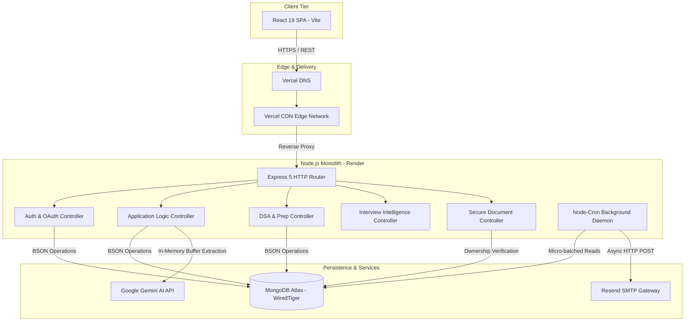
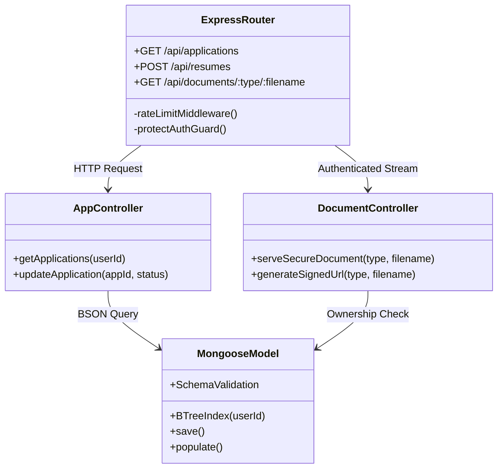
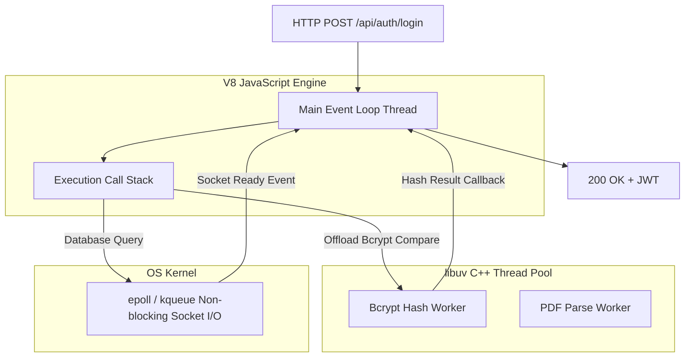
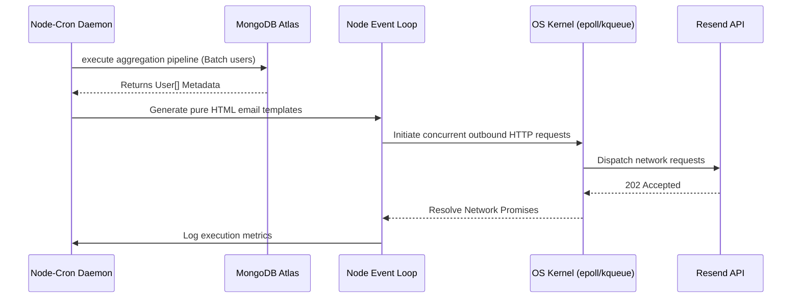
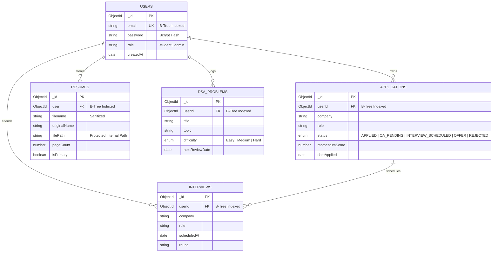

# 1. Student Placement Tracker OS

### 2. One-Sentence Description
> Enterprise-grade, AI-powered career management operating system built to centralize the software engineering placement lifecycle for candidates.

<div align="center">

[](https://opensource.org/licenses/MIT)
[](https://react.dev/)
[](https://nodejs.org/)
[](https://expressjs.com/)
[](https://www.mongodb.com/)
[](https://tailwindcss.com/)

</div>

---

## 3. Live Demo

👉 **Production Application:** [https://my-personal-tracking-system-jrnr.vercel.app/](https://my-personal-tracking-system-jrnr.vercel.app/)

- **Test Credentials / Demo Access:** Instant guest login available via the "Try Demo / Guest Login" button on the sign-in screen, or register a free candidate account.
- **Frontend Host:** Vercel Edge Network
- **Backend Host:** Render Container Monolith (Node.js LTS)
- **Database:** MongoDB Atlas (AWS cluster with Mongoose ODM)

---

## 4. Screenshots

| Comprehensive Placement Command Center | Interactive Kanban & Application Pipeline |
| :---: | :---: |
|  | *Real-time Kanban board with drag-and-drop state mutation* |

| AI-Powered ATS Resume Parsing | DSA Mastery & Interview Intelligence |
| :---: | :---: |
| *In-memory PDF text extraction & Gemini scoring* | *Curriculum telemetry, topic heatmaps, and readiness assessment* |

---

## 5. Problem

The software engineering placement process is notoriously fragmented and mentally exhausting. Candidates routinely scatter their preparation across half a dozen incompatible tools:
- **Spreadsheets / Notion:** Fragile, manual status tracking with zero automated deadline alerts.
- **LeetCode / HackerRank:** Problem histories isolated from specific company interview prep.
- **Google Calendar:** Interview events disconnected from candidate notes and debrief records.
- **Generative AI Chatbots:** Requiring repetitive copy-pasting of resumes and job descriptions without persistent context.

This siloed workflow creates high cognitive load, missed application deadlines, and zero structured visibility into candidate readiness.

---

## 6. Solution

**StudentTracker OS** serves as a singular, highly-observable control plane that consolidates the entire placement funnel:
1. **Unified Application Kanban:** Drag-and-drop status tracking with optimistic UI updates and automated status-decay heuristics.
2. **Deterministic AI Resume Tailoring:** Direct binary PDF text extraction mapped to Google Gemini 1.5 Pro to evaluate ATS fit and generate role-tailored bullet points without storing raw documents with third parties.
3. **Integrated Technical Prep & DSA Telemetry:** Built-in spaced repetition, difficulty calibration, and pattern mastery tracking directly correlated to scheduled company interviews.
4. **Automated Background Telemetry:** Scheduled cron jobs calculating candidate momentum scores and delivering weekly digest reports via Resend without blocking the main event loop.

---

## 7. Key Features

- **Dynamic Kanban State Machine:** Real-time application stage transitions (`APPLIED` $\rightarrow$ `OA_PENDING` $\rightarrow$ `INTERVIEW_SCHEDULED` $\rightarrow$ `OFFER` / `REJECTED`) with automatic audit trails.
- **Inference-Only ATS Resume Engine:** Parses in-memory PDF buffers, extracts section semantics, and scores keywords against role requirements with Google Gemini.
- **DSA Spaced Repetition & Pattern Drills:** SuperMemo-2 algorithmic review scheduling, weakness analytics, and blind implementation timers.
- **Interview Intelligence & Debriefs:** Tracks interviewer behavioral profiles, question frequency archives, and company process breakdowns.
- **Secure Document Vault:** Authenticated file downloads, path traversal defense, and temporary HMAC/JWT signed access URLs for resumes and offer letters.
- **OAuth2.0 & Stateless Session Management:** Multi-provider authentication (Google, GitHub, LinkedIn, and local bcrypt credentials) utilizing cryptographically signed JWTs.

---

## 8. Architecture

### High-Level Design (C4 Client-Server Topology)



### Low-Level Design (Controller-Service-Repository Pattern)

- **Transport (`routes/`):** Maps HTTP routes, enforces Helmet security headers, validates Bearer JWT signatures, and applies rate limiting.
- **Domain Logic (`controllers/`):** Orchestrates validation, state transformations, and third-party integrations.
- **Data Persistence (`models/`):** Strongly-typed Mongoose schemas enforce referential integrity and B-Tree indexing.



### Concurrency & Threading Model

The Node.js runtime leverages non-blocking asynchronous I/O via the OS kernel (`epoll`/`kqueue`). Synchronous CPU-intensive operations (such as bcrypt hashing and PDF binary parsing) are executed asynchronously in the C++ `libuv` worker pool, preventing V8 event loop starvation.



### Data Flow (Weekly Digest Cron Orchestration)

To prevent the N+1 query problem during scheduled background jobs, tasks execute via chunked aggregation pipelines and concurrent network dispatches:



### Database Design & Schema Relationships

StudentTracker utilizes **domain-separated MongoDB/Mongoose models with indexed access paths and explicit relationships where required**. This eliminates unbounded array growth inside single documents (preventing memory page eviction in WiredTiger) and enforces document isolation.



---

## 9. Tech Stack

| Layer | Technology | Version | Architectural Justification |
| :--- | :--- | :--- | :--- |
| **Frontend** | React SPA | 19.x | Fiber concurrent rendering keeps drag-and-drop Kanban responsive without dropped frames. |
| **Build Tool** | Vite | 8.x | Native ES modules and Rollup-based tree-shaking for rapid client bundle generation. |
| **Styling** | Tailwind CSS | 4.x | Utility-first, zero-runtime CSS footprint minimizes bundle transfer sizes. |
| **Backend API** | Node.js + Express | 5.x | High-throughput asynchronous event-driven I/O with modern native Promise routing. |
| **Database** | MongoDB Atlas | 7.x / 8.x | Document store providing flexible schema evolution with WiredTiger concurrent document-level locking. |
| **ODM** | Mongoose | 9.x | Enforces schema validation, casting, middleware hooks, and indexed access paths. |
| **AI / NLP** | Google Gemini | 1.5 Pro | Low-latency inference for resume text extraction and contextual job description scoring. |
| **Testing** | Jest + Supertest | 30.x / 7.x | Full integration testing against the actual exported Express app without mocking the server core. |
| **DevOps** | Docker, Vercel, Render | Latest | Containerized Alpine base images and edge CDN delivery. |

---

## 10. Engineering Decisions

1. **Why Express 5 Monolith instead of Microservices?**
   - *Rationale:* For early-to-mid stage placement workflows, a modular monolith minimizes network hop latency, operational cost, and distributed transaction complexity while keeping domain logic clean via controller separation.
2. **Why MongoDB with Referenced Relationships instead of Full Embedding?**
   - *Rationale:* Completely embedding 500+ solved DSA problems and 50+ job applications inside a single User document causes document growth past the 16MB BSON limit and triggers frequent MongoDB memory reallocations. Domain separation with B-Tree indexed `userId` maintains referential clarity with fast indexed reads.
3. **Why Stateless JWTs instead of Redis Sessions?**
   - *Rationale:* Eliminates a centralized state store dependency for authentication. Any backend instance can cryptographically verify identity via public/private HMAC secrets without database roundtrips.
4. **Why Inference-Only AI rather than Fine-Tuned Models?**
   - *Rationale:* ATS resume analysis is an extraction and semantic matching task. Using Google Gemini 1.5 Pro with deterministic system prompts and structured outputs avoids the high GPU hosting costs of custom fine-tuned weights while providing state-of-the-art reasoning.
5. **Why Pure JS Email Templates instead of React Email on the Server?**
   - *Rationale:* Running `@babel/register` on the server to transpile JSX emails at runtime introduced startup latency, ESM/CommonJS conflicts, and heavy dependencies. Replacing it with a pure JavaScript template function removed 74 packages and eliminated runtime transpilation overhead.

---

## 11. Setup

### Prerequisites
- **Node.js:** v20+ LTS
- **MongoDB:** MongoDB Atlas account or local MongoDB instance running on `localhost:27017`
- **Google Gemini API Key:** From [Google AI Studio](https://aistudio.google.com/)

### Running Locally

```bash
# 1. Clone the repository
git clone https://github.com/sandeep-kumar-270904/my-personal-tracking-system-.git
cd my-personal-tracking-system-

# 2. Configure environment variables (see Section 12)
# Create server/.env and client/.env

# 3. Start Backend API Server
cd server
npm install
npm run dev

# 4. In a separate terminal, start Frontend Vite Server
cd client
npm install
npm run dev
```
Open [http://localhost:5173](http://localhost:5173) in your browser.

### Docker Setup

```bash
cd server
docker build -t student-tracker-api .
docker run -p 5000:5000 --env-file .env student-tracker-api
```

---

## 12. Environment Variables

### Backend Configuration (`server/.env`)
| Variable | Required | Description |
| :--- | :---: | :--- |
| `PORT` | No | Server listen port (defaults to `5000`). |
| `MONGODB_URI` | **Yes** | MongoDB Atlas connection string (`mongodb+srv://...`). |
| `JWT_SECRET` | **Yes** | Cryptographic secret for signing JWT auth tokens. |
| `GEMINI_API_KEY` | **Yes** | Google Gemini AI API key for resume parsing. |
| `CLIENT_URL` | **Yes** | Frontend origin for CORS policy (e.g. `http://localhost:5173`). |
| `RESEND_API_KEY` | Optional | API key for automated weekly digest emails via Resend. |
| `TWILIO_ACCOUNT_SID` | Optional | SMS alert credentials. |

### Frontend Configuration (`client/.env`)
| Variable | Required | Description |
| :--- | :---: | :--- |
| `VITE_API_URL` | **Yes** | Base URL for API calls (e.g. `http://localhost:5000/api` or production URL). |

---

## 13. Testing

Integration tests run using **Jest** and **Supertest** against the actual exported Express application:

```bash
cd server
npm test
```

- **Real Route Coverage:** Tests import `app` directly from `server.js` (`const app = require('../server')`), verifying real middleware, routes, and error handling.
- **Graceful Lifecycle Hooks:** Test runs automatically guard background cron workers and Atlas connections during `NODE_ENV === 'test'`.
- **Puppeteer Mocking:** Heavy Chromium binaries are mocked via `server/__mocks__/puppeteer.js` to ensure rapid CI feedback cycles.

---

## 14. Deployment

The application features continuous deployment across both layers:

```
[Git Push to main]
       │
       ├──> Vercel CI: Builds React 19 SPA -> Deploys to Edge CDN
       │
       └──> Render CI: Builds Node.js Container -> Runs Express Monolith
                                 │
                                 └──> Connects to MongoDB Atlas Cluster
```

- **Frontend (Vercel):** Configured with root directory `/client`. Automatically compiles Vite production assets, injects edge headers, and serves client-side routing rewrites.
- **Backend (Render):** Configured with root directory `/server`. Runs `node server.js` with production environment variables and automatic container health checks.
- **Database (MongoDB Atlas):** Multi-region replica set with encrypted storage at rest.

---

## 15. Security

Architected around **Zero-Trust** and **OWASP Top 10** mitigation standards:

| Threat Vector | Mitigation Strategy | Implementation |
| :--- | :--- | :--- |
| **Insecure Direct Object Reference (IDOR)** | Authenticated Document Handling | `/uploads` is never statically served. All document streams (`/api/documents/`) verify JWT identity and enforce resource ownership before reading from disk. |
| **Path Traversal Attacks** | Strict Filename & Path Sanitization | Rejects `..`, `/`, and `\`, asserting that resolved file paths strictly reside within the designated upload directory. |
| **NoSQL Query Injection** | Deep Payload Sanitization | Custom Express 5 middleware recursively removes `$` and `.` operators from request bodies, parameters, and queries. |
| **XSS & Clickjacking** | Strict HTTP Response Headers | `helmet` enforces Content Security Policies, frameguard, and X-Content-Type-Options: nosniff. |
| **Brute Force & DDoS** | IP-Based Rate Limiting | `express-rate-limit` throttles excessive requests (200 requests per 15-minute window in production). |
| **Password Vulnerabilities** | Cryptographic One-Way Hashing | `bcryptjs` with computational work factor of 10 rounds. |
| **Web Scraping & Data Leakage** | SEO & Bot Protection | Strict `robots.txt` disallows search engines and scrapers from indexing protected `/api/`, `/dashboard/`, and `/auth/` routes. |

---

## 16. Limitations

- **Single-Host Local File Storage:** Resumes and offer documents are currently stored in the server's local file storage. In multi-instance auto-scaling setups, this requires migrating to S3/GCS object storage via the existing `documentController` abstraction.
- **Relational Aggregation Overhead:** Deep multi-model populates (e.g. Applications linked to Interviews, Contacts, and DSA Signals) rely on Mongoose `$lookup` queries, which should be cached in high-concurrency environments.
- **AI Rate Limits:** Heavy bulk resume analysis is bound by Gemini API tier quotas, necessitating client-side batching for large class cohorts.

---

## 17. Future Work

- **S3 / Cloud Storage Adapter:** Add pluggable AWS S3 / Cloudflare R2 drivers for decentralized document storage with pre-signed upload URLs.
- **Redis Cache Layer:** Introduce Redis caching for static reference datasets (company hiring patterns, standard problem lists) to decrease MongoDB read IOPS.
- **Automated Email Parsing:** Ingest interview invitation emails directly via incoming webhook parsing to automatically populate interview schedules without manual entry.
- **WebSockets for Live Interview Practice:** Real-time peer-to-peer mock interviews with collaborative code editing and WebRTC audio/video.

---

## 18. My Role

**Architect & Full-Stack Engineer** (Solo Developer)
- Architected the complete system topology from database schema design to edge deployment.
- Engineered the React 19 frontend SPA, including custom Kanban drag-and-drop mechanics and state management.
- Designed and built the RESTful Express 5 API, secure document handling service, and background cron pipeline.
- Implemented the Google Gemini NLP extraction pipeline and spaced-repetition algorithms.
- Configured CI/CD workflows, automated testing suites, and containerized Docker environments.
